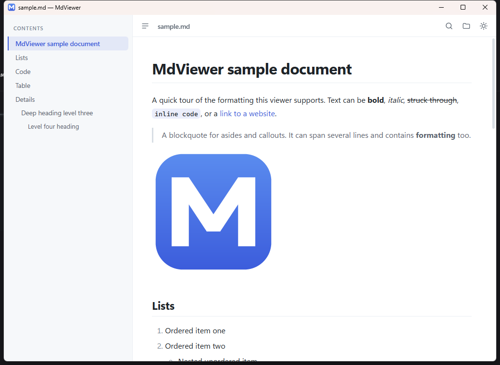
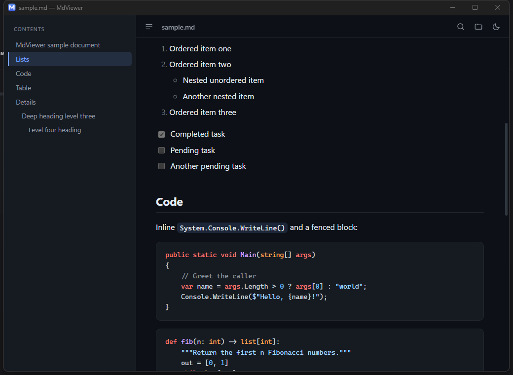

# MdViewer

A small, fast Markdown viewer for Windows. Install it per user with the MSI, with no
administrator rights needed, or build a single 2 MB `.exe` that runs from anywhere.





## Features

- **Clean typography** — GitHub-style rendering with tables, task lists, footnotes and images
- **Light and dark theme** — follows Windows by default; `Ctrl+D` cycles light, dark and
  back to following Windows, remembered between runs
- **Syntax highlighting** — about 35 common languages in fenced code blocks, from Bash
  and C# to SQL and YAML
- **Table of contents** — sidebar built from the document's headings, follows your scrolling
- **Find in document** — `Ctrl+F`, with match counter and next/previous
- **Live reload** — edit the file in any editor and the view updates by itself, keeping your place
- **Drag and drop** — drop a `.md` file onto the window
- **Relative images and links** — pictures next to the document (or in a sibling folder,
  `../images/logo.png`) just work, and links to other `.md` files open in the viewer
- **Legacy encodings** — UTF-8 with or without BOM, UTF-16, and as a fallback the
  system's legacy code page, so an old Windows-1251 file still reads

## Keyboard shortcuts

| Shortcut       | Action                        |
|----------------|-------------------------------|
| `Ctrl+O`       | Open a file                   |
| `Ctrl+F`       | Find in document              |
| `Enter` `F3`   | Next match                    |
| `Shift+Enter` `Shift+F3` | Previous match      |
| `Esc`          | Close find                    |
| `Ctrl+B`       | Show / hide the contents pane |
| `Ctrl+D`       | Theme: light → dark → follow Windows |
| `Ctrl+ +` `-`  | Zoom in / out                 |

## Install

Both ways need Windows 10 or 11 with the Microsoft Edge WebView2 Runtime, which is part
of Windows 11 and of any recent Edge install. If it is missing, MdViewer says so and
points at the [download page](https://developer.microsoft.com/microsoft-edge/webview2/).

**With the installer.** Download `MdViewer-<version>.msi` from the
[releases page](https://github.com/Chesnokovs/MD_viewer/releases) and double-click it.
It installs for the current user only — no administrator rights, no UAC prompt — into
`%LOCALAPPDATA%\Programs\MdViewer`, adds a Start menu entry, and makes `.md` files open
in MdViewer. The .NET runtime comes inside the installer, so nothing else is needed.
Uninstall from Settings › Apps like any other program.

**Without the installer.** [Build](#build-from-source) `MdViewer.exe` yourself and copy
it anywhere. This single file does not carry the .NET runtime, so the machine
also needs the [.NET 9 Desktop Runtime](https://dotnet.microsoft.com/download/dotnet/9.0).
To get the file association, run:

```powershell
.\scripts\install-file-association.ps1 -Exe "C:\Tools\MdViewer\MdViewer.exe"
```

The script only writes to `HKEY_CURRENT_USER`, so it needs no administrator rights.
`scripts\uninstall-file-association.ps1` removes it again.

Settings (theme, window size, sidebar state) are stored in
`%LOCALAPPDATA%\MdViewer\settings.json`, and the browser engine keeps its profile in
`%LOCALAPPDATA%\MdViewerrowser`. Uninstalling leaves that folder behind; delete it by
hand to remove every trace.

## One window per session

Starting the WebView2 engine is by far the slowest part of opening a document, and each
extra process starts its own engine — and waits for the browser profile lock if a
previous engine has not finished shutting down yet. That is what makes a viewer feel
slow: not the rendering, but the second launch.

So MdViewer keeps a single process per logon session: opening another `.md` file hands
the path to the window that is already running, which comes to the front and swaps the
document. Measured on a fresh browser profile:

| | A process per file | One window |
|---|---|---|
| First document | 3.3–4.0 s | 0.9 s |
| Every document after that | 3.3–4.0 s | 0.1–0.25 s |

If the running window is already closing when a new launch reaches it, the launch
notices and opens a window of its own, so a document is never silently dropped.

Set `"singleWindow": false` in `settings.json` to get a separate window per file again,
at the old cost.

## Build from source

Needs the .NET 9 SDK (a newer SDK builds it too).

```powershell
.\build.ps1
```

The result is a single file: `bin\Release\publish\MdViewer.exe`, about 2 MB. It needs the
.NET 9 Desktop Runtime on the machine; Windows does not ship it, so install it once from
the link above.

Run the unit tests (they cover the link and file rules in `LinkPolicy.cs` and the
encoding detection) with:

```powershell
.\test.ps1
```

All build scripts send intermediate files to `%TEMP%\MdViewer-build`, because a project
folder on a synced drive gets its files locked by the sync client mid-build.

To inspect the page while developing, start MdViewer with the environment variable
`MDVIEWER_DEV=1`; that enables the browser's developer tools (`F12`).

## Build the installer

One-time setup:

```powershell
dotnet tool install --global wix --version 5.*
wix extension add -g WixToolset.UI.wixext/5.0.2
```

Then:

```powershell
.\installer\build-installer.ps1 -Version 1.1.0
```

This publishes a **self-contained, ReadyToRun** build (the .NET runtime is bundled and
precompiled, so the target machine needs nothing installed and starts fast) and packages
it as `dist\MdViewer-<version>.msi`, about 39 MB. Raise `-Version` for every release,
otherwise Windows will not upgrade an existing installation.

Do not switch the publish to a compressed single file: it looks tidier but has to be
unpacked on every launch, which cost about half a second per start.

The MSI is not code-signed, so Windows SmartScreen shows an "unknown publisher" warning
on other people's machines. Signing needs a certificate from a commercial authority.

## How it works

The window is a WinForms host around a WebView2 control. Markdown is converted to HTML
in C# with Markdig; the page in `assets/` renders it, builds the table of contents and
runs the find bar. `LinkPolicy.cs` holds every rule about what a document may reach.

The interface is embedded in the executable and answered straight from memory over a
made-up host name, so nothing is unpacked to disk and there is no folder mapping to go
stale. Images and other files the document references are served from the document's
own drive, with the document's folder spelled out in the URL so that `..` paths resolve
to the real sibling folder.

## Opening files you did not write

Markdown can contain raw HTML and MdViewer renders it, so a document is treated as
untrusted input:

- The page runs under a Content Security Policy with no `unsafe-inline`, so an inline
  handler smuggled in as an `onerror` attribute cannot execute. Scripts load only from
  the executable's own assets, and the page cannot reach the network apart from images
  and audio or video.
- Nothing leaves the viewer without a click. A `<meta http-equiv="refresh">` written into
  the document is removed, and a navigation the document starts by itself is refused.
- Links only leave the app for `http`, `https` and `mailto`. A `javascript:`,
  `ms-settings:` or `file:` link is ignored.
- A link to a file must be relative, and it stays on the document's own drive or network
  share. `../other.md` works, as a documentation tree needs, but an absolute path or a
  UNC share written into the document does not.
- A link pointing at something Windows would execute, such as `.exe`, `.bat`, `.ps1` or
  `.lnk`, is shown in Explorer instead of started.
- Pictures and other files the document embeds load without a click, so they follow the
  same drive-or-share boundary. A document on `C:` cannot show a file from `D:` or from a
  network share, where merely fetching a file would hand credentials to the share's host.

Presentational inline HTML such as `<details>`, `<sub>` and `<br>` keeps working, and
remote images like README badges still load. Note that a remote image is a request to
that server: opening a document with a badge tells the badge's host that you did.

## Known limitations

- Find matches text within one run of formatting: `**bold** text` is not found by the
  query "bold text".
- Mermaid diagrams and maths are shown as their source text, not rendered.
- Relative paths inside inline `style="background: url(...)"` are not rewritten.

## Licence

MdViewer is MIT licensed — see [LICENSE](LICENSE).
Third-party components and their licences are listed in [THIRD-PARTY.md](THIRD-PARTY.md).
